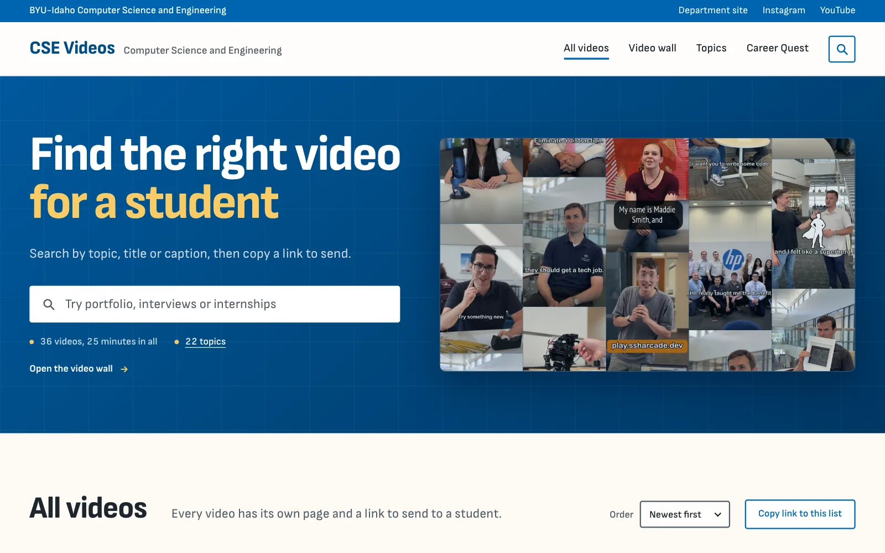
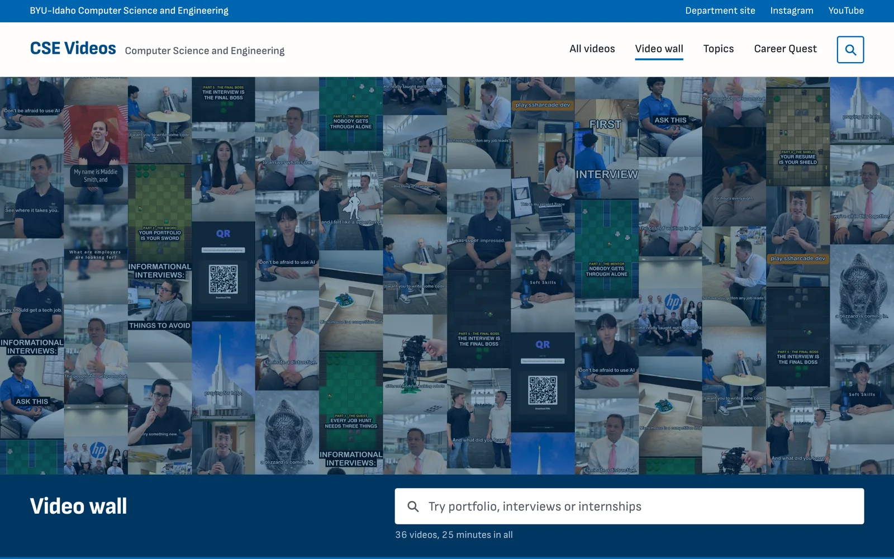
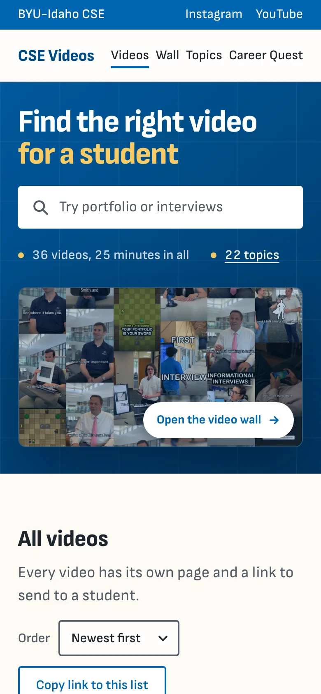

<p align="center">
  <a href="https://www.byui.edu/">
    <picture>
      <source media="(prefers-color-scheme: dark)" srcset=".github/readme/byui-logo-white-on-blue.png">
      
    </picture>
  </a>
</p>

<h1 align="center">CSE Videos</h1>

<p align="center">
  The video library of the BYU-Idaho Department of Computer Science and Engineering.<br>
  Find the right video for a student and send them the link.
</p>

<p align="center">
  <a href="https://byui-cse.github.io/cse-videos/"><strong>Open the site</strong></a>
  &nbsp;·&nbsp;
  <a href="#adding-a-video">Add a video</a>
  &nbsp;·&nbsp;
  <a href="https://github.com/byui-cse/cse-videos/issues/new">Report a problem</a>
  &nbsp;·&nbsp;
  <a href="https://www.byui.edu/computer-science-engineering/">Department site</a>
</p>

<p align="center">
  <a href="https://github.com/byui-cse/cse-videos/actions/workflows/deploy.yml"></a>
</p>

<br>

<p align="center">
  <a href="https://byui-cse.github.io/cse-videos/">
    <picture>
      <source media="(prefers-color-scheme: dark)" srcset=".github/readme/home-dark.webp">
      
    </picture>
  </a>
</p>

## What it does

The department posts short videos on job searching, interviews, student projects, and advice from faculty. This site keeps every one of them in one place so a teacher can find the right one and send it to a student who needs it.

- Search by any word in a video's title, caption, topics, or credits. The list narrows as you type.
- Browse by topic. Every topic has its own page, and a series like Career Quest plays in order.
- Share anything. Every search, topic, sort order, and video has its own address, so the link in the browser is the link to send.
- See everything at once on the Video wall. A search lights up the stills that match.
- Watch on the page. Videos play from Instagram, or from YouTube once they are posted there. When a video is on both, viewers can pick one and the site remembers it in their browser.
- Use it anywhere. Pages are plain HTML built ahead of time, so they load fast and work without JavaScript. The site works on a phone, with a keyboard, and with a screen reader, and follows the device's light or dark setting.

<p align="center">
  <picture>
    <source media="(prefers-color-scheme: dark)" srcset=".github/readme/wall-dark.webp">
    
  </picture>
  &nbsp;
  <picture>
    <source media="(prefers-color-scheme: dark)" srcset=".github/readme/phone-dark.webp">
    
  </picture>
  <br>
  <sub>The Video wall, and the home page on a phone</sub>
</p>

## Pages and links

Everything is in the address, so any view can be shared by copying the link.

| Address | Shows |
| --- | --- |
| `/` | The headline and the search beside a card holding every video's still, then every video newest first, the topics, and Career Quest. A search lights the matching stills in the card. On a phone the list opens on its first 12 videos with a button for the rest; a search always looks through all of them. |
| `/wall/` | The Video wall: every video's still in small columns at least a screen tall, with the search in a strip that stays at the foot of the screen as the wall scrolls. A search lights the stills that match and dims the rest; Enter goes to the first match. A video opened from here links back to the wall, or to its search. |
| `/wall/?q=portfolio` | The Video wall with that search lit |
| `/?q=portfolio` | A search. Every word typed has to match the start of a word in the title, description, tags, or credits. Common plurals and -ing or -ed forms count, so "jobs" finds "job", "getting" finds "get", and "coding" finds "code". |
| `/?sort=oldest` | Oldest first. Works on the home page and on topic pages; a series is always in part order. |
| `/tags/` | Every topic, the most used first, with how many videos it has and how long they run |
| `/tags/portfolio/` | The videos on one topic. A series, like Career Quest, is in part order. |
| `/videos/career-quest-part-1/` | One video and its player |
| `/videos/career-quest-part-1/?source=instagram` | The same video, playing from Instagram instead of YouTube |

Pressing YouTube or Instagram above a video, or in the "Play videos on" switch in the blue bar at the top (shown once any video has both links), also sets a soft preference: later videos open on that player when they have it, and a video on only the other one plays there with a short "Only on Instagram" or "Only on YouTube" note. The preference is kept in this browser only and is never added to the address, so a shared link with `?source=` still opens on the player it names.

## Adding a video

Anyone with write access can add a video from github.com. No tools need to be installed.

1. Open [`data/videos.json`](data/videos.json) and click the pencil. Paste the template below right after the opening `[`, including its trailing comma, then replace the example values. The site sorts by date, so position in the file does not matter.
2. Commit the edit to a new branch. On that same branch, open `src/covers/` and use **Add file > Upload files** to add a 480×750 JPEG under 150 KB named `<id>.jpg`. That one file is all a video needs; the build makes the smaller copies the pages use. On a Mac, make one from a still of the reel (JPEG, PNG or HEIC, taller than 480:750 as reel frames are) with `sips -s format jpeg --resampleWidth 480 -c 750 480 still.png --out <id>.jpg`, replacing `still.png` with your file and `<id>` with the video's id. It scales the still to 480 wide and trims the top and bottom to 750.
3. Open a pull request from your branch. The checks run on their own. If you see a red X, click **Details** to read what needs fixing, then edit the files on the same branch.
4. Once the checks pass and the pull request is merged, the site updates itself within a few minutes.

```json
{
    "id": "career-quest-part-1",
    "title": "Career Quest, Part 1: Every job hunt needs three things",
    "description": "The caption from the Instagram post.",
    "instagram": "https://www.instagram.com/reel/POST_CODE/",
    "length": "1:05",
    "datePosted": "2026-10-19",
    "series": "career-quest",
    "part": 1,
    "tags": ["career-quest", "job-search"]
},
```

Use a unique id and reel link. For a standalone video, delete the `series` and `part` lines.

| Field | Required | Format |
| --- | --- | --- |
| `id` | Yes | Unique lowercase words joined by hyphens; used in the video's link, so don't change it once live. |
| `title` | Yes | The video's title. |
| `description` | No | The Instagram caption without hashtags; write `\n` for a line break, `\n\n` for a new paragraph, and `\"` for a double quote. |
| `instagram` | Yes, unless using YouTube | An https Instagram post or reel link. |
| `youtube` | No | An https YouTube video link (watch, youtu.be, or shorts). With both links, the page plays YouTube and offers an Instagram switch. A YouTube video may omit the cover; the site uses its thumbnail. |
| `length` | No | `m:ss` or `h:mm:ss`. |
| `attributions` | No | A list of credits; links may use `[text](https://url)`. |
| `datePosted` | Yes | `YYYY-MM-DD`; lists sort by this date. |
| `dateCreated` | No | `YYYY-MM-DD`. |
| `tags` | Yes | A list of tag ids from [`data/tags.json`](data/tags.json). |
| `series` | With `part` | A lowercase slug for videos in a series, like `career-quest`. It must also be one of the video's tags. |
| `part` | With `series` | A whole number starting at 1. Each part appears once, with no gaps. |
| `stats` | No | Counts, like `{ "newPeople": 3, "projects": 1 }`. |

The current covers are stills taken from each reel, saved at 480×750.

### Tag names

Tags are shown on the site as topics. Every tag must be listed in [`data/tags.json`](data/tags.json). Reuse an existing id whenever possible. To introduce a new tag, add its id and display name there in the same pull request.

## Running it locally

Needs Node 20.9 or newer.

```sh
npm install
npm run dev
```

The site runs at http://localhost:5190 and rebuilds whenever you save a file. Refresh the page to see the change.

| Command | What it does |
| --- | --- |
| `npm run dev` | Builds the site, serves it, and rebuilds on save |
| `npm run build` | Builds the site into `dist/`, including smaller copies of the covers |
| `npm run validate` | Checks `data/videos.json` and `data/tags.json` and lists any problems |
| `npm test` | Runs the unit tests |
| `npm run test:e2e` | Runs the browser tests in headless Chromium (run `npx playwright install chromium` once first) |

## Deploying

Every push to `main` runs the data checks and unit tests, then deploys the site to GitHub Pages at [byui-cse.github.io/cse-videos](https://byui-cse.github.io/cse-videos/). Pull requests run those checks plus the browser tests, without deploying. Both workflows are in [`.github/workflows/`](.github/workflows/).

### Repository settings

- **Pages source** (admins and maintainers). Settings > Pages > Build and deployment > Source must be **GitHub Actions**. It is set already. If the site ever stops updating after a merge, check this first, then the Actions tab.
- **Access** (admins). Settings > Collaborators and teams. Student maintainers need the Maintain role, which covers merging pull requests and everything in this README except the settings marked for admins.
- **A byui.edu address** (admins). A repo admin enters the address under Settings > Pages > Custom domain first. Then BYU-Idaho IT adds a CNAME record that points it at `byui-cse.github.io`. Once the DNS check passes, turn on **Enforce HTTPS**. The build reads the site's address from Pages on every deploy, so links, sharing previews, and the sitemap follow without any code changes.

## How it's put together

Plain HTML, CSS, and JavaScript, built by a small Node script. There is no framework to keep up to date, and the only packages are build and test tools.

| Folder | What's in it |
| --- | --- |
| `data/` | `videos.json`, every video and its details, and `tags.json`, the topic names. This is the department's record of its videos. |
| `src/covers/` | One 480×750 JPEG still per video, named by its id |
| `lib/pages/` | One file per kind of page: `home.js`, `video-wall.js`, `video.js`, `tags.js`, `not-found.js`, with `layout.js` and `parts.js` for what they share |
| `lib/` | Everything the build uses to write the pages: sorting and counting (`site.js`), related videos and series (`related.js`), the walls (`wall.js`), the covers (`images.js`), structured data, the sitemap, and robots.txt (`seo.js`), HTML escaping (`html.js`), and the data checks (`videos.js`) |
| `src/js/` | Search, sorting, the link buttons, the player, and the wall in the browser, starting from `main.js` |
| `src/css/` | The design, in cascade layers: tokens, base, layout, components, utilities |
| `src/fonts/` | Self-hosted fonts and their licenses |
| `scripts/` | `build.js`, `dev.js`, and `validate.js`, behind the npm commands above |
| `test/` and `e2e/` | Unit tests (`npm test`) and browser tests (`npm run test:e2e`) |

Details worth knowing before changing it:

- Every page is written as plain HTML at build time, so pages load fast, work without JavaScript, and show a title and cover when a link is shared. `lib/render.js` gathers them for the build. Every value from the data goes through `lib/html.js`, which escapes it.
- `lib/wall.js` arranges the walls: the shuffle, the copies that fill the card and the Video wall (on the Video wall a row of them first, since that row is lifted past the top edge), and the Video wall's row counts, which the build adds to the stylesheet so the wall is always tall enough to show every video whole.
- `lib/images.js` makes AVIF and WebP copies of each cover at 240, 360 and 480 pixels wide with [sharp](https://sharp.pixelplumbing.com/), and every still offers them through `srcset` and `sizes` with the JPEG as the fallback. The copies are written into `dist/` and cached in `node_modules/.cache/`, named by the cover's contents and every setting that shapes them, so a rebuild only makes copies of new or changed covers, or all of them after a setting changes. They are never committed.
- `src/js/search.js` is shared with the build, so search matches the same words everywhere.
- `motion.js` is the only motion that runs on its own: Career Quest's boards fade up once. Everything else responds to a pointer, a key, or a click: a still on a wall lights up and is named in one label (the card's corner, or the Video wall's strip; `wall.js`, which also runs the Video wall's search), stills in the grid zoom slightly inside their frames, Career Quest's boards lift with a gold edge, and the still you click carries into the next page's player (`transition.js`, a cross-document view transition). With reduced motion turned on, nothing moves; the short fades on the wall stay.
- The wall in the home page's card is for the pointer. Every video on it is also in the list below, so its links are left out of the tab order and hidden from screen readers. On the Video wall each video's own still is a link named by its title, after the search in the tab order; the copies that fill the rest of the screen are hidden from screen readers and the keyboard, and during a search so are the videos that don't match.
- `src/js/main.js` holds the first paint until it has run (`blocking="render"`), with every module it imports preloaded beside it. Without that, Chromium paints a page while its modules are still loading and drops the page-to-page view transition with an error.
- The look: a BYU-Idaho blue utility bar over a white header, a home hero in the manner of the department's CS & SE site (a blue gradient under a faint grid, the second line of the headline in gold, the wall in a framed card), navy bands, a blue footer, square stills, and 4 px corners on controls, in the CS & SE colors. The build bundles it into one file with [Lightning CSS](https://lightningcss.dev/). Light and dark follow the device.
- Pages carry a strict Content Security Policy: no inline styles, and no inline scripts except the one on Instagram video pages, which the policy allows by its hash.

## Brand

- The BYU-Idaho logo at the top of this page is the university's official file from [University Communications](https://www.byui.edu/branding/logos), unchanged. If you use it anywhere else, follow the [logo guidelines](https://www.byui.edu/branding/logos/official): don't recolor, crop, stretch, or redraw it, and don't place it beside another organization's logo without approval from University Communications.
- `src/favicon.svg` is a placeholder, the letters CSE in white on navy. BYU-Idaho's [department logo guidelines](https://www.byui.edu/branding/logos/department) ask departments to use their approved logo instead of making their own marks, so replace it with the department's approved file when it is added.
- Colors come from the department's CS & SE site. Fonts are Sofia Sans and Sofia Sans Semi Condensed under the SIL Open Font License, self-hosted as variable WOFF2 files from Fontsource, latin only. The licenses are in `src/fonts/`.
- The videos and their stills come from the department's Instagram, [@byui.cse](https://www.instagram.com/byui.cse/).

<br>

<p align="center">
  <sub>Brigham Young University-Idaho &nbsp;·&nbsp; Department of Computer Science and Engineering &nbsp;·&nbsp; Rexburg, Idaho</sub>
</p>
